# Panduan Aplikasi Kopkar POS untuk Anggota (Android)

Aplikasi ini membantu anggota Kopkar Kusuma Lestari melihat sisa limit belanja, belanja mandiri, melihat riwayat transaksi, dan menunjukkan kartu anggota ke kasir.

> Gambar di panduan ini adalah tangkapan layar versi 1.0.9 dari akun uji. Nama, nominal, dan data transaksi pada gambar hanya contoh.

## 1. Memasang aplikasi

*Pindai QR di atas dengan kamera HP untuk membuka halaman unduhan.*

1. Buka alamat unduhan atau tulis di peramban: **update.kopkarksk.com**.
2. Unduh file APK, lalu buka.
3. Jika diminta, izinkan **"Pasang aplikasi tidak dikenal"** untuk peramban yang Anda pakai.
4. Setelah terpasang, buka aplikasi **Kopkar POS**.

Pengguna iPhone memakai versi web di **ios.kopkarksk.com** (buka lewat Safari, lalu *Tambahkan ke Layar Utama*).

Pembaruan berikutnya bisa diperiksa dari menu **Profil → Cek pembaruan**.

## 2. Masuk (login)

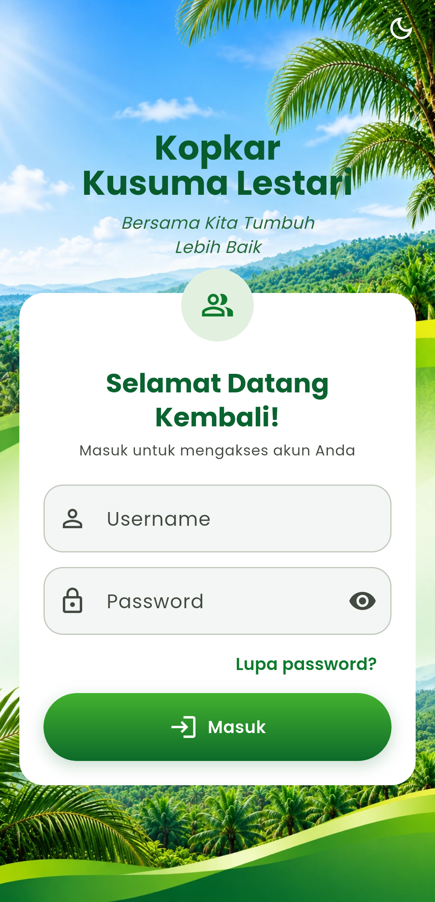

- **Username:** NIK Anda (nomor anggota).
- **Password:** password sementara dari admin koperasi.
- Pada login pertama Anda **wajib mengganti password**. Pilih password baru yang tidak mudah ditebak.
- Lupa password? Ketuk **Lupa password?** di layar login, lalu hubungi admin koperasi untuk reset.

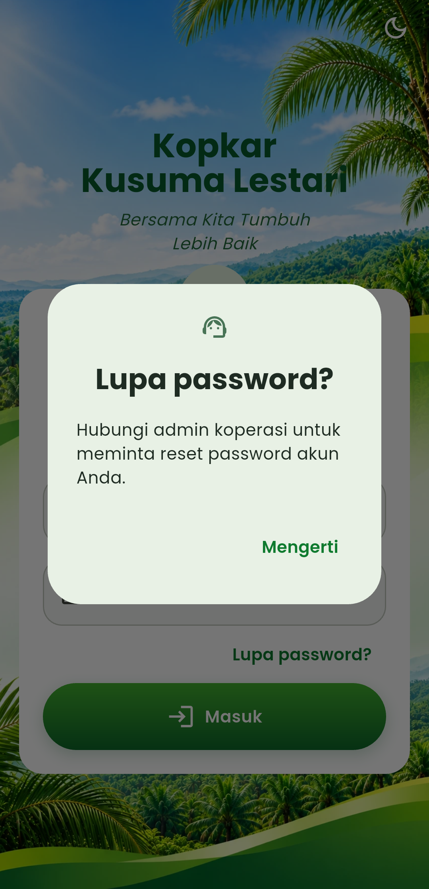

## 3. Beranda (Dashboard)

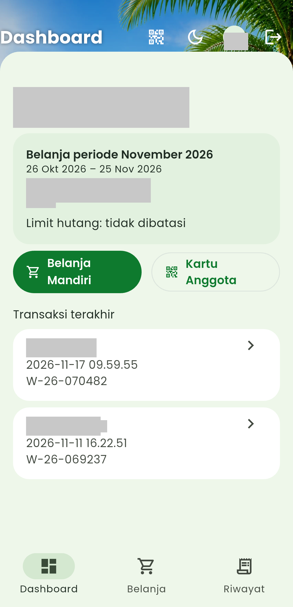

Beranda menampilkan:

- **Belanja periode ini** - total belanja kredit Anda pada periode berjalan (contoh: 26 Okt 2026 - 25 Nov 2026).
- **Limit hutang** - batas belanja per periode. Tulisan *tidak dibatasi* berarti Anda tidak punya batas. Limit **dihitung ulang setiap periode**, bukan saldo yang menumpuk.
- **Belanja Mandiri** dan **Kartu Anggota** - tombol cepat.
- **Transaksi terakhir** - ketuk untuk melihat rinciannya.

Tarik layar ke bawah untuk menyegarkan data. Ikon QR di pojok kanan atas membuka Kartu Anggota, ikon bulan mengganti tema gelap/terang, lingkaran inisial membuka Profil.

**Jika muncul "Belanja belum bisa dilakukan":** periode belum dibuka oleh admin. Tunggu atau hubungi pengurus. Jika limit terlampaui, tampil tulisan merah *Melebihi limit Rp ...*.

## 4. Belanja Mandiri

Buka tab **Belanja**.

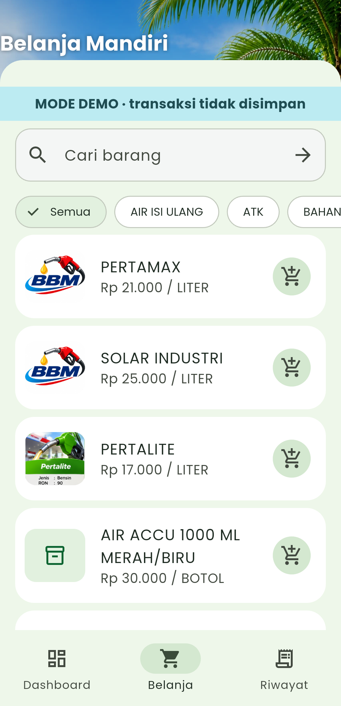

1. Cari barang lewat kolom **Cari barang** atau pilih kategori (Semua, Air Isi Ulang, ATK, ...).
2. Ketuk ikon keranjang di kanan barang untuk menambahkan. Ketuk **+** / **-** untuk mengubah jumlah.

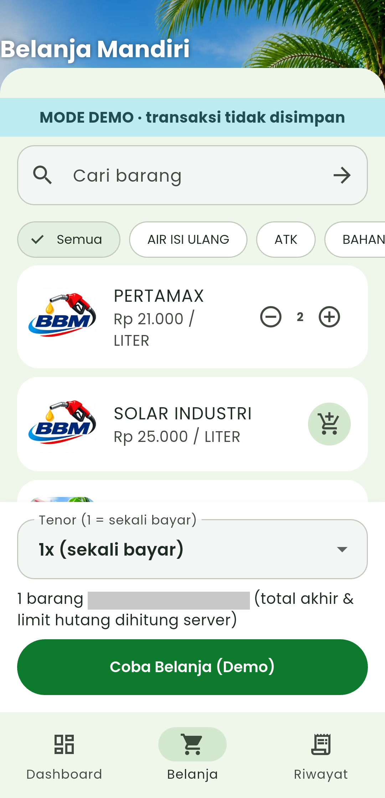

3. Pilih **Tenor**: *1x (sekali bayar)* atau cicilan 2x sampai 12x.
4. Periksa ringkasan di bawah. Angka itu **perkiraan**; total akhir dan pemeriksaan limit dihitung oleh server.
5. Ketuk **Belanja dengan Kredit**.

Pembayaran selalu kredit (potong gaji). Jumlah barang hanya bilangan bulat.

### Mode demo

Jika akun Anda berstatus demo, layar menampilkan **MODE DEMO** dan tombolnya bertuliskan *Coba Belanja (Demo)*.

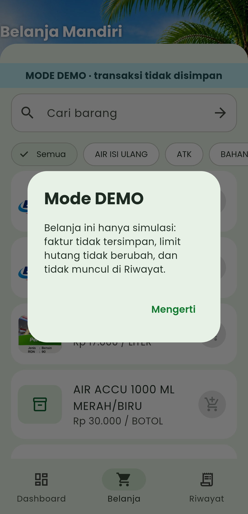

Belanja demo hanya simulasi: faktur tidak tersimpan, limit tidak berubah, dan tidak muncul di Riwayat.

### Struk

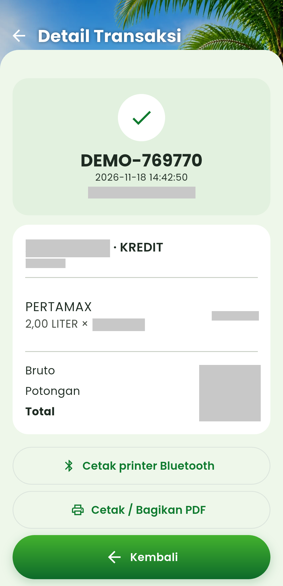

Setelah berhasil, muncul detail transaksi. Anda bisa **Cetak printer Bluetooth** atau **Cetak / Bagikan PDF**, lalu **Kembali**.

## 5. Riwayat transaksi (Transaksi Saya)

Buka tab **Riwayat**.

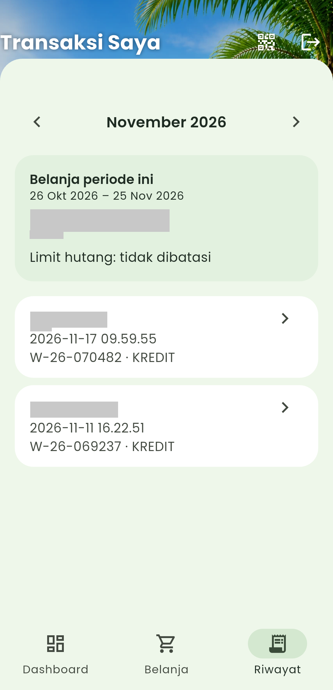

- Gunakan panah kiri/kanan di atas untuk berpindah periode.
- Kartu hijau menunjukkan total belanja dan limit periode tersebut.
- Ketuk satu transaksi untuk melihat rinciannya.

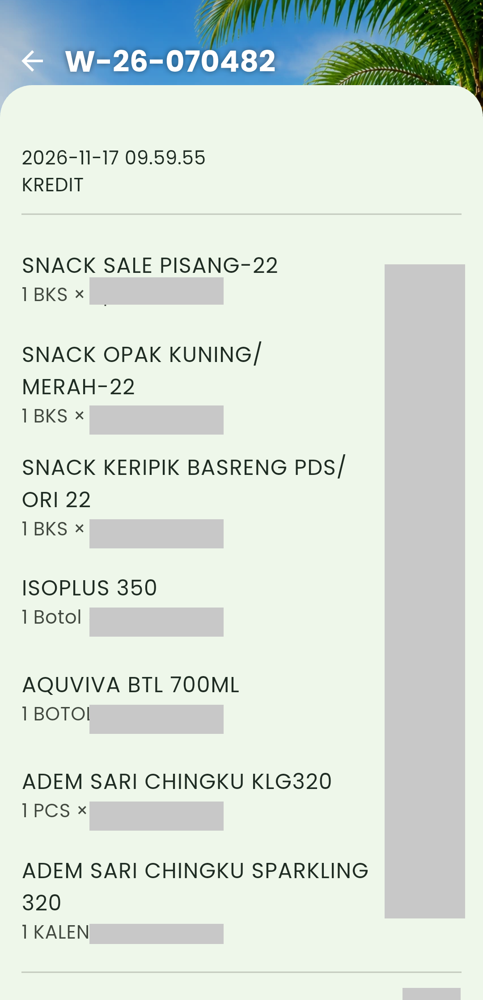

Rincian memuat tanggal, jenis pembayaran (KREDIT), barang, jumlah, dan harga. Untuk transaksi cicilan, jadwal angsuran ditampilkan di bagian bawah.

## 6. Kartu Anggota (QR)

Ketuk ikon QR di pojok atas atau tombol **Kartu Anggota**.

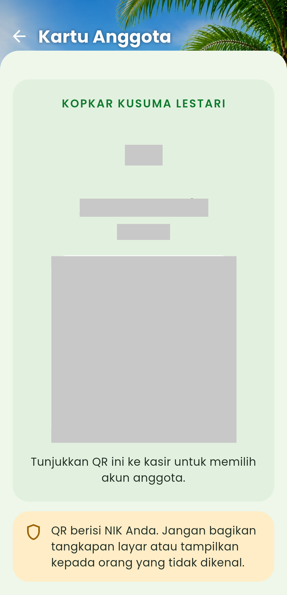

Tunjukkan QR ini ke kasir agar akun anggota Anda dipilih saat transaksi di kasir.

> **Penting:** QR berisi NIK Anda. Jangan membagikan tangkapan layar atau menunjukkannya kepada orang yang tidak dikenal. Pada gambar di atas QR sengaja ditutup.

## 7. Profil, ganti password, dan versi

Ketuk lingkaran inisial di Beranda.

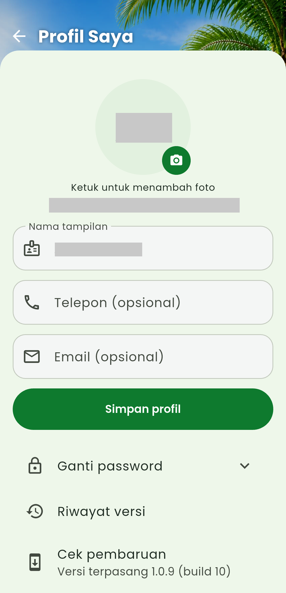

- **Foto**: ketuk lingkaran foto/ikon kamera.
- **Nama tampilan, telepon, email**: isi lalu ketuk **Simpan profil**.
- **Ganti password**: ketuk untuk membuka kolom ganti password.
- **Riwayat versi**: daftar perubahan aplikasi.
- **Cek pembaruan**: memeriksa versi terbaru.

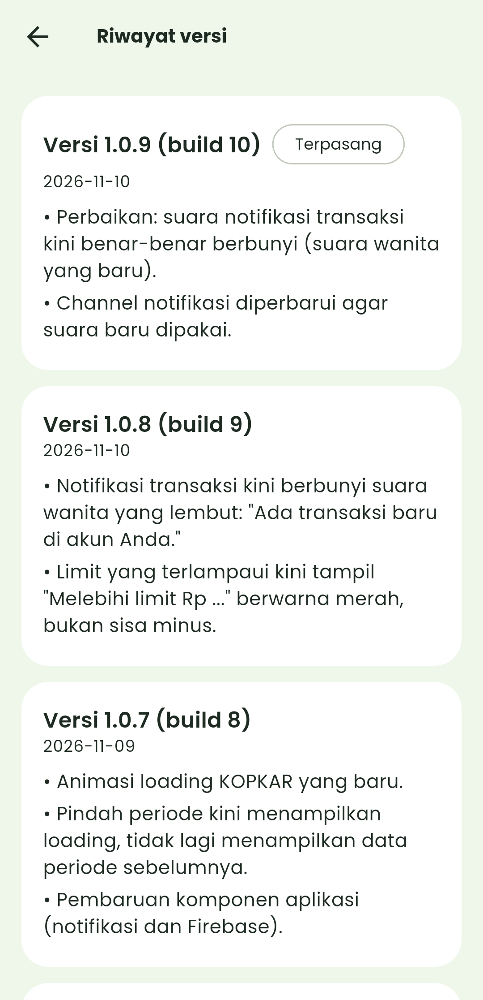

Untuk keluar, ketuk ikon panah keluar di pojok kanan atas.

## 8. Pemecahan masalah

| Masalah | Yang bisa dilakukan |
|---|---|
| Tidak bisa masuk | Pastikan username adalah NIK. Lupa password: hubungi admin untuk reset. |
| Tulisan "Coba lagi" / gagal memuat | Periksa sinyal internet, lalu ketuk **Coba lagi** atau tarik layar ke bawah. |
| "Barang tidak ditemukan" | Ubah kata kunci atau pilih kategori **Semua**. |
| Tombol Belanja tidak aktif / "Periode belum dibuka" | Periode belanja belum dibuka admin. Hubungi pengurus. |
| "Melebihi limit Rp ..." | Belanja periode ini sudah melewati limit Anda. Tunggu periode berikutnya atau hubungi pengurus. |
| Transaksi tidak muncul di Riwayat | Periksa periode yang dipilih. Belanja mode demo tidak pernah tersimpan. |
| Notifikasi transaksi tidak berbunyi | Pastikan notifikasi aplikasi Kopkar POS diizinkan di pengaturan HP, dan perbarui ke versi terbaru. |
